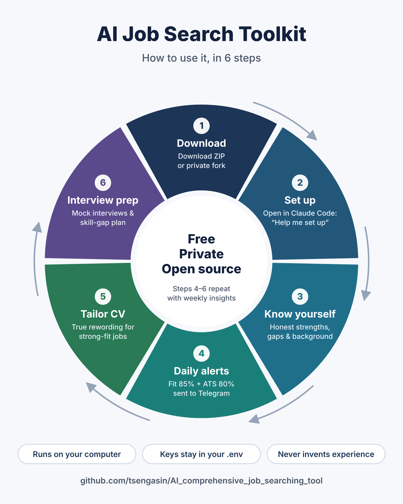

# AI Comprehensive Job Searching Tool

**Free AI skills for job seekers: build and tailor your CV, prepare for interviews, and get a
daily alert only for jobs you genuinely fit. Runs on your own computer with your own AI agent.
No server, no sign-up, no data collection.**

[繁體中文說明](README.zh-Hant.md)

<p align="center"></p>

---

## What it does

| | Skill | You say... | You get |
|---|---|---|---|
| 1 | **cv-builder** | "Build my CV" / "Tailor my CV for this job" | A master CV, tailored versions with an ATS keyword check, a change log and a gap analysis. Never invents experience. |
| 2 | **interview-coach** | "I have an interview at X on Friday" | Role brief, STAR story bank, question bank, graded mock interviews, tough-conversation drills, a day-by-day plan to close skill gaps, and a practice log |
| 3 | **job-match-alert** | "Should I apply to this?" (or runs daily) | Two scores per job, **Fit %** and **ATS Match %**, a Telegram digest of jobs that clear your bar, a spreadsheet tracker, and weekly insights |
| + | **skill-profile-builder** | "What are my real strengths and gaps?" | An honest Tier 1/2/3 skill profile, level check and personal factors. This is what makes the scores trustworthy |
| + | **job-search-setup** | "Help me set up" | A step-by-step guided setup |

## Why two scores?

Recruiters say your CV should match **80–85%** of a job ad. That is about **wording**: will
the ATS and a 30-second scan find the right terms? Whether you should apply is a different
question: **honest fit**, including your gaps, level, language, visa and background.

This toolkit scores both, and applies hard caps so keyword overlap can't hide a real mismatch
(e.g. a required skill you don't have, or a "head of" role when your evidence is executor-level).

| | ATS ≥ 80 | ATS < 80 |
|---|---|---|
| **Fit ≥ 85** | 🟢 Apply now | 🟡 **Tailor CV first**: a job you fit that your CV would lose |
| **Fit < 85** | 🟠 Stretch / ⚪ Skip | 🟠 Stretch / ⚪ Skip |

The 85% fit bar comes from real use: in the author's own search, jobs above it were the ones
that led to interviews. → [Full method](docs/04-scoring-method.md) ·
[Worked example](examples/demo-persona/sample-scoring.md)

## Get started

1. Download this repo (Code → Download ZIP), or fork it and **make your fork private**.
2. Open the folder in [Claude Code](https://claude.com/claude-code) and type:
   **"Help me set up the job search tool."**

Prefer reading? → [Quick start, step by step](docs/01-quick-start.md) (about 45 minutes).

You only need skills 1 and 2? No keys required: just open the folder in your AI agent and ask.
The daily alert needs free keys from Jooble and/or SerpApi and a Telegram bot
([how](docs/02-api-keys.md)).

Works with Claude Code out of the box. Other agents (Codex, Cursor, Gemini CLI...) can follow
[`AGENTS.md`](AGENTS.md); the daily scorer currently uses the Claude Code CLI.

## Your data and keys are safe by design

- Runs **100% on your computer**. The author never receives your CV, data or keys.
- Keys live in `.env`; CV and results in `my-data/` and `data/`. All git-ignored.
- The daily AI scorer runs sandboxed with **no shell and no internet access**, so a malicious job
  ad can't trick it into leaking anything.
- Official APIs only. No LinkedIn scraping.

→ [SECURITY.md](SECURITY.md)

## How the daily alert works

```
 Jooble / SerpApi ──► fetch & de-duplicate ──► AI scores (sandboxed: Read/Write only)
                                                      │
 Telegram digest ◄── tracker data/jobs.xlsx ◄── Python validates scores & sets verdicts
```

```bash
python -m job_alert run        # daily pipeline
python -m job_alert insights   # weekly: missing CV terms, recurring gaps, strengths in demand
python -m job_alert doctor     # check setup without showing keys
```

## Repo map

| Path | What |
|---|---|
| `.claude/skills/` | The five skills (plain Markdown, easy to read and adapt) |
| `job_alert/` | Daily alert pipeline (Python) |
| `docs/` | Quick start, keys, scheduling, scoring method |
| `templates/` | Skill profile, CV and mock-interview log templates |
| `examples/demo-persona/` | A fictional job seeker's CV, profile and sample scoring |
| `my-data/` | **Your** private files (git-ignored) |

## Contributing

Issues and PRs welcome, especially new official job sources, translations, and interview
modules. Please read [SECURITY.md](SECURITY.md) first, and never include real keys or personal
data in an issue.

## License

[MIT](LICENSE). See also the [disclaimer](DISCLAIMER.md): scores are estimates, not guarantees.
