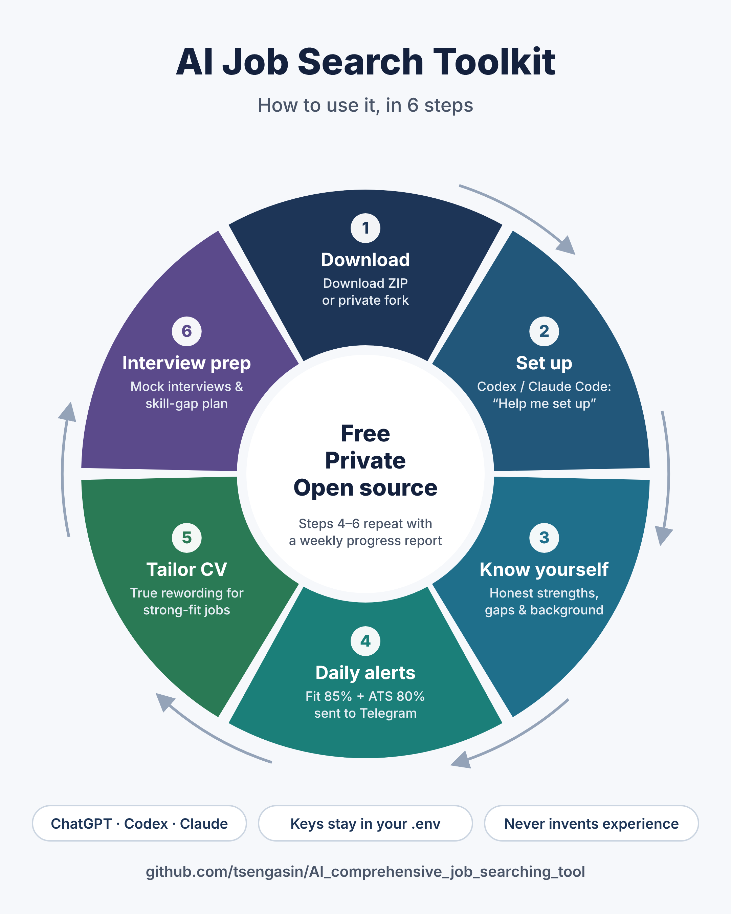
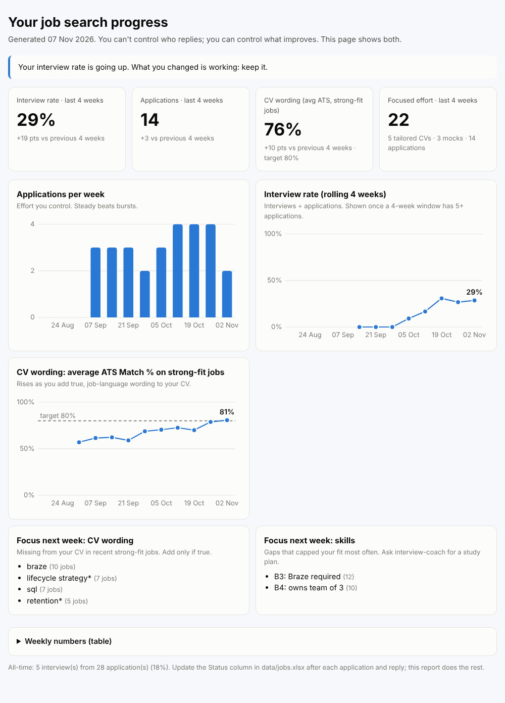

# AI 全方位求職工具

**免費的 AI 求職技能包：製作及度身修改履歷、準備面試，每天只通知你真正適合的職位。支援 ChatGPT／Codex、Claude 及任何 OpenAI 相容模型（如 DeepSeek、Qwen、Azure OpenAI、本機 Ollama）。全部在你自己的電腦運行，不設伺服器、不用註冊、不收集任何資料。**

[English README](README.md)

## 功能

| 技能 | 你可以說 | 你會得到 |
|---|---|---|
| **cv-builder** | 「幫我寫履歷」／「按這份 JD 改我的履歷」 | 主履歷、針對職位的版本、ATS 關鍵字檢查、修改紀錄及差距分析。**絕不虛構經驗** |
| **interview-coach** | 「我星期五要面試 X 公司」 | 職位解讀、STAR 故事庫、題庫、逐題評分的模擬面試、棘手對話練習、技能差距的每日學習計劃 |
| **job-match-alert** | 「這份工值得申請嗎？」（或每天自動運行） | 每份工兩個分數：**Fit %** 及 **ATS Match %**；Telegram 每日摘要、Excel 追蹤表、每週分析 |
| **skill-profile-builder** | 「我真正的強項和弱項是甚麼？」 | 誠實的技能分層（Tier 1/2/3）、職級檢查及個人因素 |
| **job-search-setup** | 「幫我安裝」 | 一步一步的引導式設定 |
| **job-search-coach** | 「你好」／「下一步做甚麼？」 | 主動檢查你的進度並帶領你：申請這份、為那份改履歷、準備面試、跟進未回覆的申請 |

## 會自我進化的求職流程

求職最難受的，是投出履歷後石沉大海。這個工具把求職變成一個循環：**搵工 → 行動 → 記錄 → 量度 → 改進**。每份見過的工、每次申請、每個回覆，都會回饋到下星期：你履歷缺少的字眼、最常拖低你分數的技能差距，以及你的改動有沒有效。

你不用再問「下一步做甚麼」：每日摘要最後都會列出你的**下一步**，AI 教練亦會在每次對話開始時，主動提出今天最值得做的一件事。

每星期你會收到一份**進度報告**：面試率、申請數、履歷字眼與職位語言的吻合度、你付出的努力，以及下星期最值得專注的一件事。即使某星期沒有回音，你也看得到自己在哪方面進步、下一步該做甚麼。詳見 [docs/07-progress-loop.md](docs/07-progress-loop.md)。

## 為甚麼要兩個分數？

- **ATS Match %（目標 80–85%）**：招聘人員常說履歷要「夾」到職位廣告的 80–85%。這是指**字眼和行業術語**是否對得上，能否通過 ATS 系統篩選。
- **Fit %（門檻 85%）**：把你的真實技能、職級、弱項及背景（語言、簽證、地點等）都計算在內後，你和這份工實際有多適合。

系統會先套用「硬上限」：例如必要條件是你的已知弱項、要求年資比你多兩年以上、職位要求「主導／擁有」但你的經驗屬執行層級。這些情況下，關鍵字再多也不能把分數拉高。

| | ATS ≥ 80 | ATS < 80 |
|---|---|---|
| **Fit ≥ 85** | 🟢 立即申請 | 🟡 **先改履歷**：你做得到，但履歷會被篩走 |
| **Fit < 85** | 🟠 進取之選／⚪ 略過 | 🟠 進取之選／⚪ 略過 |

## 開始使用

按你平時用的 AI 選擇：

| 你用… | 做法 | 可用功能 |
|---|---|---|
| **只用 ChatGPT 網頁版** | 把技能檔案上載到 ChatGPT Project（[10 分鐘教學](docs/06-use-in-chatgpt.md)） | 履歷、技能檔案、面試準備、為你貼上的職位評分 |
| **Codex**（ChatGPT 付費計劃）或 **Claude Code** | 下載此 repo，打開資料夾，輸入 **「Help me set up the job search tool.」**（用中文亦可） | 全部功能，包括每日職位通知 |
| **API key**（Azure OpenAI、DeepSeek、Qwen、OpenRouter 等）或 **Ollama** | 同上，並在 config 設定 `engine.type: api` | 全部功能，包括每日職位通知 |

下載：**Code → Download ZIP**（如 fork，請**設為 Private**）。詳細步驟見 [docs/01-quick-start.md](docs/01-quick-start.md)；選擇 AI 見 [docs/05-choose-your-ai.md](docs/05-choose-your-ai.md)。只用履歷及面試功能的話，不需要任何 API key。

> **注意：** OpenAI 及 Anthropic 官方均未支援香港，請以各供應商的支援地區及條款為準。香港用戶可考慮 Azure OpenAI（合資格機構）、DeepSeek、阿里雲 Qwen，或在電腦本機運行的免費 Ollama。

## 安全與私隱

- **100% 在你的電腦運行**，作者不會收到你的履歷、資料或任何 key。
- API key 只存於 `.env`；履歷及結果存於 `my-data/` 和 `data/`，全部已被 git 忽略。
- 每日評分的 AI 在沙盒內運行，**沒有上網權限**，惡意職位廣告無法誘使它洩露資料。
- 評分時，你的履歷及職位內容會傳送給你選用的 AI 供應商（不會傳給作者）。如不想資料離開電腦，可用 Ollama。
- 只使用官方 API，不爬 LinkedIn。

詳見 [SECURITY.md](SECURITY.md)。**切勿把 API key 貼到任何 AI 對話、GitHub issue 或截圖中。**

## 授權

[MIT](LICENSE)。分數只是估算，並非保證，詳見[免責聲明](DISCLAIMER.md)。
