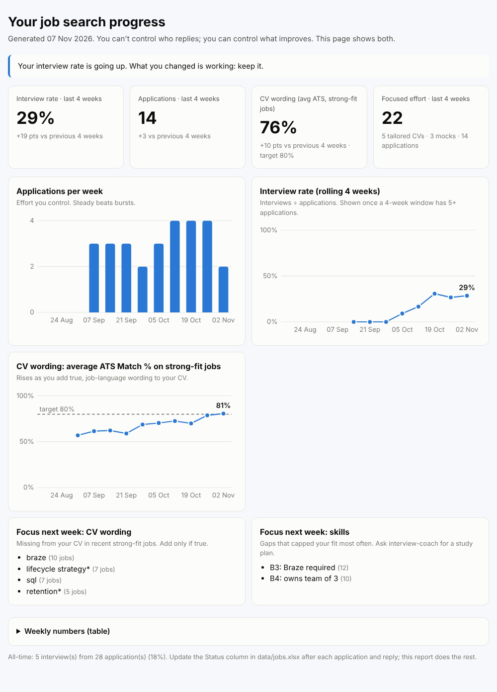

# The improvement loop and your progress report

Job searching mostly feels like waiting and rejection, and rejections rarely say why. This
toolkit turns every day of searching into feedback, so you improve each week and can **see**
that you are improving, even before the offers arrive.

## How the loop works

```
   ┌──► 1. Find: daily alert scores new jobs (Fit % and ATS %)
   │          │
   │    2. Act: apply to 🟢, tailor the CV for 🟡, practise with interview-coach
   │          │
   │    3. Record: set the Status in data/jobs.xlsx (Applied, Interview, Rejected...)
   │          │
   │    4. Measure: weekly progress report (interview rate, CV wording, effort)
   │          │
   └─── 5. Improve: fix the top missing CV terms, train the top skill gap,
                update your skill profile, so tomorrow's scores and CVs are better
```

Every job you see, every application and every interview feeds the next week: missing ATS
terms show you what to add to your CV, gap flags show you what to learn, and the interview
rate shows whether the changes worked.

## What you do

Open `data/jobs.xlsx` and update the **Status** column (there is a dropdown) when something
happens:

| Status | When |
|---|---|
| New | Default for every job the alert finds |
| Applied | You sent an application |
| Interview | You were invited to any interview round |
| Offer | 🎉 |
| Rejected | They said no (at any stage) |
| No reply | About 3 weeks with no answer |
| Not applying | You decided to skip it |

You never type dates. Each daily run notices status changes and records when they happened.

## What you get

Every week (Monday by default, `reports.progress_day` in `config.yaml`) you get a Telegram
summary, and `data/progress-report.html` is updated. Open it in your browser any time, or run:

```bash
python -m job_alert progress
```



| In the report | Why it helps |
|---|---|
| **Interview rate** (rolling 4 weeks), with change vs the previous 4 weeks | The outcome that matters most. Shown once there are at least 5 applications, so a single rejection doesn't swing it |
| **Applications per week** | Steady effort beats bursts |
| **CV wording: average ATS %** on strong-fit jobs, with your target line | Rises as you add true, job-language wording to your CV: the earliest sign of progress |
| **Focused effort**: tailored CVs (files in `my-data/tailored/`), mock interviews (logs in `my-data/interview-prep/*/04_practice_log/`), applications | Things fully in your control |
| **Focus next week**: top missing CV terms and top skill gaps | One clear thing to work on, instead of a vague sense of failing |

## Reading it kindly

- Results lag effort by a few weeks. A flat interview rate while your ATS line rises usually
  means the improvement hasn't reached recruiters yet.
- Small numbers are noisy. 1 interview from 6 applications (17%) and 0 from 6 can both be luck.
  Look at the 4-week trend, not one week.
- Rejection is data about the match, the timing and the wording, not a verdict on you.
